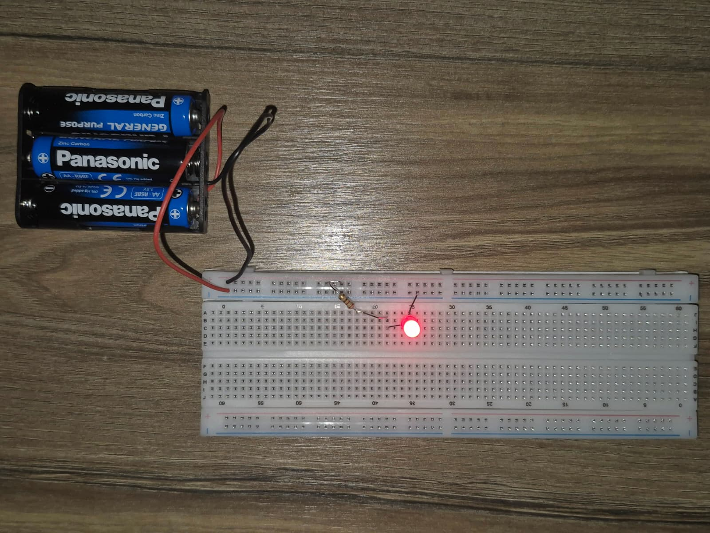

# 01 – Ohm's Law & LED

**Goal:** Understand how a series resistor sets the current through an LED and check Ohm's law (V = I·R) with real measurements.
**Components:** 3 × AA battery pack (4.5 V nominal), breadboard, red LED, 220 Ω / 1 kΩ / 10 kΩ resistors, multimeter
**Circuit:** 

## Method
For each resistor I measured the voltage across it (V_R) and calculated the current with I = V_R / R.

## What I measured
| R (Ω) | V_R (V) | I = V_R / R (mA) |
|---|---|---|
| 220 | 2.34 | 10.6 |
| 1000 | 2.64 | 2.64 |
| 10000 | 2.85 | 0.285 |

Data: [measurements.csv](data/measurements.csv)

## What I learned
- The resistor sets the current: I = (Vs − V_LED) / R.
- A bigger resistor means less current, and the LED gets dimmer.

